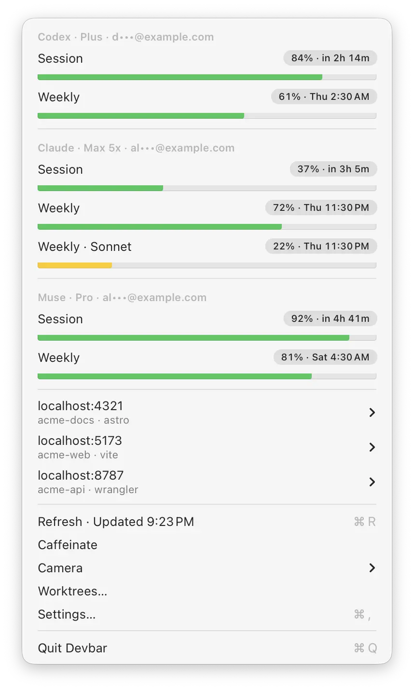
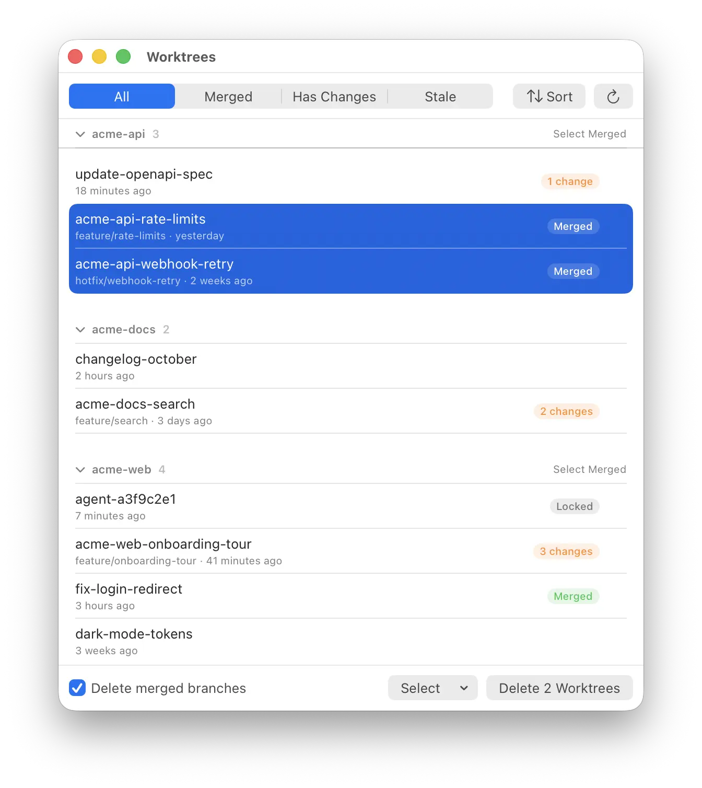

Am I about to hit my Claude limit? When does Codex reset? What's running on port 5173? Why do I have 40 worktrees?

Four questions. Four places to find the answer. A usage page, a CLI, `lsof`, `git worktree list`.

I ask them all day. I wanted the answers one click away.

So I built [Devbar](https://devbar.praveenjuge.com).

## Quota at a glance

The top of the menu has a section for each AI tool I use: Codex, Claude, and Muse. Every quota window gets a bar, how much is left, and when it resets.

The bar turns yellow below 25% and red below 10%. That's it. You know if you can start the big refactor or should wait until Thursday.

- No sign-in. Devbar reuses the logins your Codex CLI, Claude Code, and Muse already saved, and only reads them.
- Emails are masked, so you can screenshot it without sharing your address.
- It refreshes every 10 minutes and whenever you open the menu.

## Dev servers, without the terminal hunt

Below the quota is every dev server running on your Mac. `localhost:4321`, the project folder, the process name.

Hover a row to open it in the browser, copy the URL, or stop it. No more digging through twelve terminal tabs to find what's still holding port 3000.

System services and apps are left out. Only processes started from a project folder show up.

## Clean up after your agents

This is the one I needed most.

Coding agents create a git worktree for every task. They add up fast. Most are merged and forgotten. Some still have changes. A few are locked because an agent is working in them right now.

The Worktrees window finds every one in your home folder, grouped by repo, with pills for **Merged**, **changes**, **Locked**, and **Missing**. Merged covers squash and rebase merges too, so a branch merged on GitHub counts even when your local copy is behind.

Select merged. Delete. Devbar always asks first, warns about uncommitted changes, and never selects locked worktrees. Branches that aren't merged are kept.

Deleting worktrees should be boring. Losing work by accident shouldn't be possible.

## Two small extras

- **Camera** lists the apps allowed to use your camera. Click one to take access back.
- **Caffeinate** keeps the display awake during a long build. Same as `caffeinate -d`, minus the terminal.

## Small, native, quiet

Devbar is built with Swift and AppKit. No Dock icon. No main window. It sits next to the clock and stays out of the way.

No account. No analytics. Updates are signed, notarized, and download in the background.

## Try it

Get the `.dmg` from the [latest release](https://github.com/praveenjuge/devbar/releases/latest), drag it to Applications, and click the gauge in your menu bar. It needs an Apple Silicon Mac on macOS 14 or later.

It's free, and the [code is on GitHub](https://github.com/praveenjuge/devbar). If you're shipping websites with those agents, [Nuni](/blog/i-built-nuni-to-comment-on-real-websites/) lets you comment on the live site and hand the fix back to them.

Install it, let your agents make a mess, and tell me what Devbar should clean up next.
